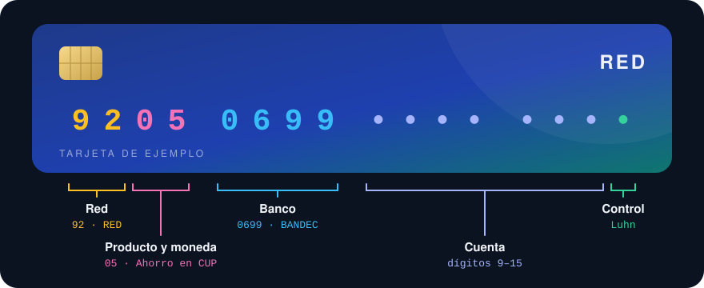
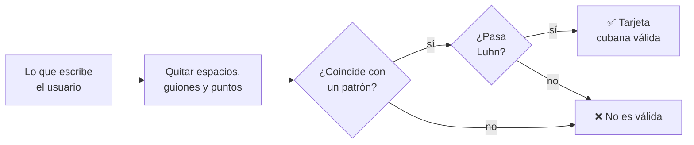

<div align="center">



# Prefijos de tarjetas cubanas

**Qué producto, qué moneda y qué banco hay detrás de cada tarjeta cubana.**<br>
Un catálogo abierto, con sus fuentes, y validadores listos para usar en cualquier lenguaje.

<!-- badges:start -->
    [](LICENSE) [](https://github.com/qvapay/cuban_cards_prefixes/actions/workflows/check.yml)
<!-- badges:end -->

[Inicio rápido](#-inicio-rápido) · [Anatomía](#-anatomía-de-una-tarjeta) · [Prefijos](#-prefijos) · [Validar](#-validar-un-número) · [Formato](#-formato-de-los-datos) · [Contribuir](#-contribuir) · [English](#-english)

</div>

---

## ✨ Para qué sirve

- **Validar formularios.** Rechaza al momento un número que no es una tarjeta cubana o que tiene un dígito mal tecleado.
- **Decir qué tarjeta es mientras se escribe.** Con los 8 primeros dígitos ya puedes mostrar «Tarjeta en CUP · BANDEC · Ahorro».
- **Evitar envíos a la tarjeta equivocada.** Distingue CUP, USD con respaldo en MLC y la Clásica antes de mandar el dinero.
- **Sin dependencias, en cualquier lenguaje.** Son dos ficheros JSON y unas expresiones regulares.
- **Con fuentes.** Cada prefijo dice de dónde sale, y lo que no está confirmado se marca como tal.

> [!NOTE]
> No es una fuente oficial de ningún banco. Es un catálogo comunitario: verifica los datos antes de usarlos para mover dinero.

## ⚡ Inicio rápido

Los datos se pueden usar directamente desde la CDN de jsDelivr, que admite CORS y sirve también en el navegador, o desde GitHub:

```text
https://cdn.jsdelivr.net/gh/qvapay/cuban_cards_prefixes@main/validators.json
https://cdn.jsdelivr.net/gh/qvapay/cuban_cards_prefixes@main/prefixes.json
https://raw.githubusercontent.com/qvapay/cuban_cards_prefixes/main/prefixes.json
```

```js
const v = await fetch('https://cdn.jsdelivr.net/gh/qvapay/cuban_cards_prefixes@main/validators.json').then(r => r.json())

const n = '9205 0699 0000 0000'.replace(new RegExp(v.normalize.strip_pattern, 'g'), '')

new RegExp(v.patterns.cup).test(n)     // true: es una tarjeta en CUP
new RegExp(v.issuers.BANDEC).test(n)   // true: es de BANDEC
// Falta el dígito de control: ver «Validar un número»
```

`@main` siempre trae la última versión. Para fijar una, cambia `@main` por un commit o una etiqueta.

| Fichero | Qué contiene |
|---|---|
| [`prefixes.json`](prefixes.json) | El catálogo: estructura del número, bancos, prefijos con su producto y su moneda, y fuentes. Es el único fichero que se edita a mano. |
| [`validators.json`](validators.json) | Expresiones regulares generadas a partir del catálogo: por moneda, por banco y para la Clásica. |
| [`schema.json`](schema.json) | El esquema de `prefixes.json` (JSON Schema 2020-12). |

## 🔢 Anatomía de una tarjeta

Las tarjetas de la red **RED** tienen 16 dígitos:

| Dígitos | Qué indican | Ejemplo |
|:-:|---|---|
| 1–2 | Red RED | `92` |
| 3–4 | Producto y moneda | `05`: ahorro en CUP |
| 5–8 | Banco | `0699`: BANDEC |
| 9–15 | Cuenta | |
| 16 | Dígito de control [Luhn](https://es.wikipedia.org/wiki/Algoritmo_de_Luhn) (ISO/IEC 7812) | |

Con los **4 primeros dígitos** ya se sabe el producto y la moneda. Con los **8 primeros**, también el banco.

La tarjeta **Clásica** (`9760`) no sigue esta estructura: sus dígitos 5–8 no son un código de banco.

## 🏦 Bancos

<!-- banks:start -->
| Banco | Dígitos 5–8 | Patrón |
|---|:-:|---|
| **BANDEC** · Banco de Crédito y Comercio | `0699` | `issuers.BANDEC` |
| **BPA** · Banco Popular de Ahorro | `1299` | `issuers.BPA` |
| **Banco Metropolitano** | `95··` (parcial) | `issuers.METROPOLITANO` |
| **BICSA** · Banco Internacional de Comercio S.A. | `04··` (parcial) | `issuers.BICSA` |
| **FINCIMEX** · Financiera CIMEX S.A. | — | `patterns.clasica` |
<!-- banks:end -->

## 📋 Prefijos

<!-- prefixes:start -->
### 🇨🇺 Pesos cubanos (CUP)

| Prefijo | Producto | Confirmado en | Fuentes |
|:-:|---|---|:-:|
| **`9200`** | _Sin identificar_ · [¿la tienes?](https://github.com/qvapay/cuban_cards_prefixes/issues/new?template=prefijo.yml&prefix=9200) ¹ | — | C |
| **`9202`** | _Sin identificar_ · [¿la tienes?](https://github.com/qvapay/cuban_cards_prefixes/issues/new?template=prefijo.yml&prefix=9202) | — | C |
| **`9204`** | Nómina, fondos, ahorro | BANDEC | B · C |
| **`9205`** | Ahorro | BANDEC | B · C |
| **`9206`** | Jubilación | BANDEC | B · C |
| **`9210`** | Colaboradores | BANDEC | B · C · T |
| **`9211`** | Colaboradores | BANDEC | B · C · T |
| **`9212`** | Trabajadores por cuenta propia (TCP) | BANDEC | B · C |
| **`9213`** | Trabajadores por cuenta propia (TCP) | BANDEC | B · C |
| **`9216`** | Subsidios | BANDEC | B · C |
| **`9224`** | Nómina, fondos, ahorro | BANDEC | B · C |
| **`9227`** | Nómina, fondos, ahorro | BANDEC | B · C |
| **`9233`** | MIPYMES / cooperativas no agropecuarias | BANDEC | B · C |
| **`9234`** | _Sin identificar_ · [¿la tienes?](https://github.com/qvapay/cuban_cards_prefixes/issues/new?template=prefijo.yml&prefix=9234) | — | C |
| **`9237`** | Agricultores / usufructuarios | BANDEC | B · C |
| **`9238`** | _Sin identificar_ · [¿la tienes?](https://github.com/qvapay/cuban_cards_prefixes/issues/new?template=prefijo.yml&prefix=9238) | — | C |
| **`9244`** | _Sin identificar_ · [¿la tienes?](https://github.com/qvapay/cuban_cards_prefixes/issues/new?template=prefijo.yml&prefix=9244) | — | C |
| **`9248`** | _Sin identificar_ · [¿la tienes?](https://github.com/qvapay/cuban_cards_prefixes/issues/new?template=prefijo.yml&prefix=9248) | — | C |

> ¹ **`9200`**: El catálogo comunitario la describe como «Tarjeta en CUP», sin propósito concreto.

### 💵 USD con respaldo en MLC

| Prefijo | Producto | Confirmado en | Fuentes |
|:-:|---|---|:-:|
| **`9225`** | Ahorro de personas naturales | BANDEC | B · C |
| **`9226`** | TCP / productores agropecuarios | BANDEC | B · C |
| **`9228`** | Cooperativas / MIPYMES | BANDEC | B · C |
| **`9229`** | Otras entidades ¹ | BANDEC | B · C |
| **`9235`** | Ahorro de personas naturales | BANDEC | B · C |
| **`9240`** | Ahorro de personas naturales · «Tropical» ² | BANDEC | B · C |
| **`9245`** | _Sin identificar_ · [¿la tienes?](https://github.com/qvapay/cuban_cards_prefixes/issues/new?template=prefijo.yml&prefix=9245) | — | C |
| **`9250`** | Cooperativas / MIPYMES | — | C |

> ¹ **`9229`**: El catálogo comunitario la describe como «Personas jurídicas».
>
> ² **`9240`**: BANDEC la agrupa con las tarjetas en USD con respaldo en MLC. El catálogo comunitario la llama «Tropical» y la clasifica como prepago en USD.

### 💳 USD

| Prefijo | Producto | Confirmado en | Fuentes |
|:-:|---|---|:-:|
| **`9760`** | Clásica ¹ | FINCIMEX | C |

> ¹ **`9760`**: No sigue la estructura RED: los dígitos 5–8 no son un código de banco.
<!-- prefixes:end -->

**Confirmado en** son los bancos en los que una fuente confirma ese producto. No es una lista cerrada: el mismo producto puede existir en otros bancos, y los validadores lo aceptan en cualquier banco conocido. Las letras de **Fuentes** se explican en [Fuentes](#-fuentes).

## ✅ Validar un número



1. **Normaliza** el número: quita lo que indica `normalize.strip_pattern`.
2. **Compara** con un patrón de `validators.json`.
3. **Comprueba el dígito de control** Luhn. Una expresión regular no puede hacerlo, pero son pocas líneas de código.

| Patrón | Acepta |
|---|---|
| `patterns.any` | Cualquier tarjeta cubana del catálogo |
| `patterns.red` | Cualquier tarjeta de la red RED |
| `patterns.cup` | Tarjetas en CUP |
| `patterns.usd` | Tarjetas en USD, incluida la Clásica |
| `patterns.usd_mlc` | Tarjetas en USD con respaldo en MLC |
| `patterns.clasica` | Tarjeta Clásica |
| `issuers.<BANCO>` | Tarjetas RED de ese banco |

Los patrones usan `[0-9]` en lugar de `\d`, porque en Python y en otros motores `\d` también acepta dígitos que no son ASCII. Funcionan igual en JavaScript, Python, PHP, Java, Go, Dart y Ruby.

<details open>
<summary><b>JavaScript</b></summary>

```js
const BASE = 'https://cdn.jsdelivr.net/gh/qvapay/cuban_cards_prefixes@main'
const [catalog, v] = await Promise.all(
  ['prefixes.json', 'validators.json'].map(f => fetch(`${BASE}/${f}`).then(r => r.json()))
)

const luhn = (n) => {
  let sum = 0
  for (let i = 0; i < n.length; i++) {
    let d = Number(n[n.length - 1 - i])
    if (i % 2) { d *= 2; if (d > 9) d -= 9 }
    sum += d
  }
  return sum % 10 === 0
}

const normalize = (raw) => String(raw ?? '').replace(new RegExp(v.normalize.strip_pattern, 'g'), '')

// kind: any | red | cup | usd | usd_mlc | clasica
const isCubanCard = (raw, kind = 'any') => {
  const n = normalize(raw)
  return new RegExp(v.patterns[kind]).test(n) && luhn(n)
}

// { prefix, currency, mlc_backed, product, bank } o null
const describe = (raw) => {
  const n = normalize(raw)
  if (!isCubanCard(n)) return null
  const p = catalog.prefixes.find(p => p.prefix === n.slice(0, 4))
  const bank = Object.keys(v.issuers).find(id => new RegExp(v.issuers[id]).test(n)) ?? p.issuers[0] ?? null
  return { prefix: p.prefix, currency: p.currency, mlc_backed: p.mlc_backed, product: p.product, bank }
}

describe('9205 0699 0000 0000')
// { prefix: '9205', currency: 'CUP', mlc_backed: false, product: 'Ahorro', bank: 'BANDEC' }
```

</details>

<details>
<summary><b>Python</b></summary>

```python
import json, re, urllib.request

BASE = 'https://cdn.jsdelivr.net/gh/qvapay/cuban_cards_prefixes@main'

def load(name):
    with urllib.request.urlopen(f'{BASE}/{name}') as r:
        return json.load(r)

catalog, v = load('prefixes.json'), load('validators.json')

def luhn(n):
    total = 0
    for i, ch in enumerate(reversed(n)):
        d = int(ch)
        if i % 2:
            d = d * 2 - 9 if d > 4 else d * 2
        total += d
    return total % 10 == 0

def normalize(raw):
    return re.sub(v['normalize']['strip_pattern'], '', str(raw or ''))

def is_cuban_card(raw, kind='any'):
    n = normalize(raw)
    return re.match(v['patterns'][kind], n) is not None and luhn(n)

def describe(raw):
    n = normalize(raw)
    if not is_cuban_card(n):
        return None
    p = next(p for p in catalog['prefixes'] if p['prefix'] == n[:4])
    bank = next((bank for bank, pattern in v['issuers'].items() if re.match(pattern, n)), None)
    return {
        'prefix': p['prefix'],
        'currency': p['currency'],
        'mlc_backed': p['mlc_backed'],
        'product': p['product'],
        'bank': bank or next(iter(p['issuers']), None),
    }

describe('9205 0699 0000 0000')
# {'prefix': '9205', 'currency': 'CUP', 'mlc_backed': False, 'product': 'Ahorro', 'bank': 'BANDEC'}
```

</details>

<details>
<summary><b>PHP</b></summary>

```php
<?php
$base = 'https://cdn.jsdelivr.net/gh/qvapay/cuban_cards_prefixes@main';
$v = json_decode(file_get_contents("$base/validators.json"), true);

function luhn(string $n): bool {
    $sum = 0;
    foreach (array_reverse(str_split($n)) as $i => $ch) {
        $d = (int) $ch;
        if ($i % 2) { $d *= 2; if ($d > 9) $d -= 9; }
        $sum += $d;
    }
    return $sum % 10 === 0;
}

function normalizeCard(string $raw, array $v): string {
    return preg_replace('/' . $v['normalize']['strip_pattern'] . '/', '', $raw);
}

// $kind: any | red | cup | usd | usd_mlc | clasica
function isCubanCard(string $raw, array $v, string $kind = 'any'): bool {
    $n = normalizeCard($raw, $v);
    return preg_match('/' . $v['patterns'][$kind] . '/', $n) === 1 && luhn($n);
}

// 'BANDEC' | 'BPA' | 'METROPOLITANO' | 'BICSA' | null
function bankOf(string $raw, array $v): ?string {
    $n = normalizeCard($raw, $v);
    if (!isCubanCard($n, $v, 'red')) return null;
    foreach ($v['issuers'] as $id => $pattern) {
        if (preg_match('/' . $pattern . '/', $n) === 1) return $id;
    }
    return null;
}

var_dump(isCubanCard('9205 0699 0000 0000', $v, 'cup')); // bool(true)
var_dump(bankOf('9205-0699-0000-0000', $v));             // string(6) "BANDEC"
```

</details>

## 📦 Formato de los datos

Cada prefijo de `prefixes.json` tiene esta forma:

```json
{
  "prefix": "9240",
  "network": "RED",
  "currency": "USD",
  "mlc_backed": true,
  "product": "Ahorro de personas naturales",
  "aliases": ["Tropical"],
  "issuers": ["BANDEC"],
  "sources": ["bandec_post", "community_catalog"],
  "notes": "BANDEC la agrupa con las tarjetas en USD con respaldo en MLC. El catálogo comunitario la llama «Tropical» y la clasifica como prepago en USD."
}
```

| Campo | Qué es |
|---|---|
| `prefix` | Los 4 primeros dígitos |
| `network` | `RED`, o `null` si el producto no sigue la estructura RED (la Clásica) |
| `currency` | `CUP` o `USD` |
| `mlc_backed` | `true` si es USD con respaldo en MLC, como lo llama BANDEC. `null` si no se sabe |
| `product` | Producto o propósito. `null` si todavía no se ha identificado |
| `aliases` | Otros nombres con los que se conoce |
| `issuers` | Bancos en los que una fuente confirma el producto |
| `sources` | Fuentes de ese dato (lista `sources` al final del fichero) |
| `notes` | Aclaraciones y contradicciones entre fuentes |

En `issuers`, el campo `code` son los dígitos del banco a partir de la posición 5. Si tiene menos de 4 dígitos, el resto todavía no se conoce.

## 📚 Fuentes

<!-- sources:start -->
| | Fuente | Qué aporta |
|:-:|---|---|
| **B** | ¿Sabías que los dígitos de tu tarjeta Bandec revelan su propósito? | Publicación atribuida a BANDEC sobre los dígitos 3–4 de sus tarjetas. |
| **C** | Cuban Bank Card Prefixes v1.0.0 (2026-06-20) | Catálogo comunitario. Para la estructura del número cita el documento «Tomo 2 Digital». |
| **T** | Titulares de tarjeta | Titulares que confirman el código de banco de BANDEC (0699) y BPA (1299) y tarjetas BANDEC 9210 y 9211. |
| **ISO** | [ISO/IEC 7812-1: números de identificación de tarjetas](https://en.wikipedia.org/wiki/ISO/IEC_7812) | El último dígito de un número de tarjeta es un dígito de control Luhn. |
<!-- sources:end -->

## 🔍 Ayúdanos a completarlo

- El producto de los prefijos marcados como _Sin identificar_ en las tablas.
- Los dígitos 7–8 de Banco Metropolitano y de BICSA.
- Si `9240` («Tropical») es una cuenta en USD con respaldo en MLC, como la agrupa BANDEC, o un prepago en USD, como dice el catálogo comunitario.
- La entidad emisora de la Clásica y qué significan sus dígitos 5–8.
- El enlace a la publicación de BANDEC.

¿Tienes una de esas tarjetas o una fuente? [Cuéntanoslo](https://github.com/qvapay/cuban_cards_prefixes/issues/new?template=prefijo.yml).

## 🤝 Contribuir

- **Con un issue**: el formulario de [nuevo prefijo o corrección](https://github.com/qvapay/cuban_cards_prefixes/issues/new?template=prefijo.yml) pide los 8 primeros dígitos, el banco, la moneda, el producto y la fuente.
- **Con un pull request**:
  1. Edita `prefixes.json` y cita la fuente de cada dato: un enlace, un documento o tu propia tarjeta.
  2. Ejecuta `npm run build`. Regenera `validators.json` y las tablas de este README.
  3. Ejecuta `npm run check`. Comprueba que el catálogo es coherente y que lo generado está al día. Lo mismo corre en cada pull request.

> [!WARNING]
> **Nunca publiques un número de tarjeta completo** en un issue, un pull request o un commit. Para identificar un producto bastan los 8 primeros dígitos.

## 🇺🇸 English

<details>
<summary>Summary in English</summary>

An open catalog of **Cuban bank card prefixes**: which product, currency and bank sit behind the first digits of a Cuban card, plus ready-to-use validators for any language.

- [`prefixes.json`](prefixes.json): the catalog (card structure, banks, prefixes and sources). Texts are in Spanish.
- [`validators.json`](validators.json): regular expressions generated from the catalog, by currency (`cup`, `usd`, `usd_mlc`, `clasica`, `any`) and by bank (`BANDEC`, `BPA`, `METROPOLITANO`, `BICSA`).
- [`schema.json`](schema.json): JSON Schema 2020-12 for `prefixes.json`.

Cards on the Cuban **RED** network have 16 digits: digits 1–2 are the network (`92`), 3–4 the product and currency, 5–8 the bank (`0699` BANDEC, `1299` BPA), 9–15 the account and 16 a Luhn check digit.

To validate a number: strip spaces, hyphens and dots (`normalize.strip_pattern`), match it against a pattern and check the Luhn digit. See the code samples above.

This is a community catalog, not an official source. Never post a full card number in an issue or pull request: the first 8 digits are enough.

</details>

---

<div align="center">
<sub>Hecho con 💙 por <a href="https://qvapay.com">QvaPay</a> y la comunidad · <a href="LICENSE">Licencia MIT</a></sub>
</div>
